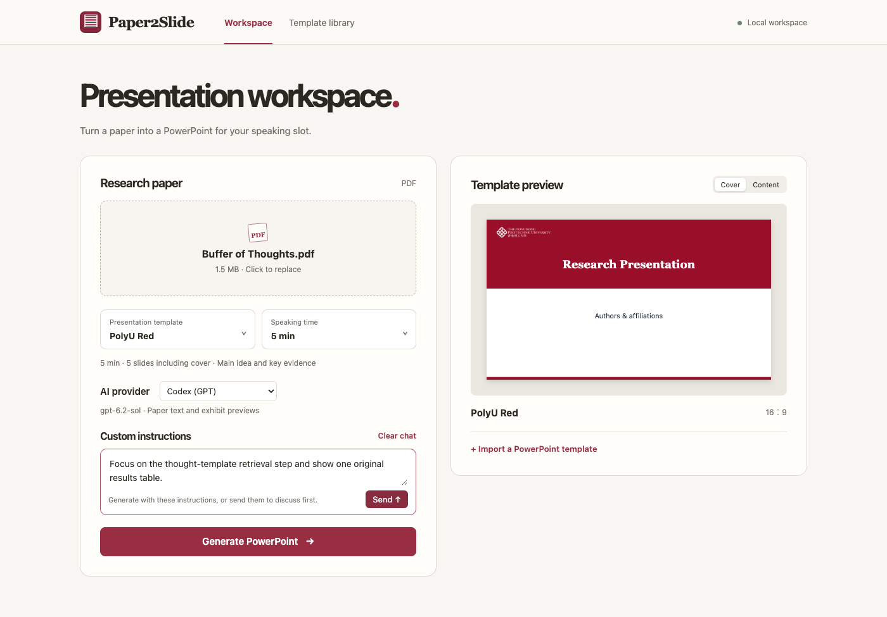

# Paper2Slide
**A Reusable Agent Skill for Turning Research Papers into Presentation Slides**

PENG Cheng · REN Shoupeng · ZHAO Shihan · ZHONG Yue

Paper2Slide pairs a paper-reading and presentation-planning skill with an editable PowerPoint renderer. Use the skill in your existing AI agent, or run the browser app to upload a PDF and generate a timed talk. The two bundled designs are **PolyU Red** and **PolyU Blue**.



## Example presentations

Both editable decks present *Buffer of Thoughts* in five minutes. Open them in PowerPoint to see the original exhibits, section headings and timed speaker notes.

| Design | Example |
| --- | --- |
| PolyU Red | [Download the five-slide talk](docs/decks/Buffer-of-Thoughts-PolyU-Red.pptx) |
| PolyU Blue | [Download the six-slide talk with its native closing slide](docs/decks/Buffer-of-Thoughts-PolyU-Blue.pptx) |

[View the English template library screenshot](docs/images/template-library.png).

## Option A — use the skill directly

Give an attachment-capable agent the paper PDF and [SKILL.md](skills/build-paper-beamer-deck/SKILL.md), keeping the skill folder and its assets available. In Codex, copy the entire `skills/build-paper-beamer-deck` folder into `~/.codex/skills/` and start a new chat. For example:

> Use build-paper-beamer-deck. Turn the attached paper into a five-minute talk for first-year graduate students. Use PolyU Red, show the original results table, and give me editable slides with speaker notes.

The agent asks for speaking time when missing, reads the paper, selects the narrative and evidence, and follows the requested output format. It can use the bundled Beamer template (XeLaTeX/latexmk), or the provided single-result-slide PPTX renderer. Standalone output depends on the agent's file and rendering capabilities. The complete-deck PPTX renderer is included in the app.

## Option B — run the web app

Requires Python 3.12+, a configured model, and a browser. Install LibreOffice with `soffice` on PATH if you want to import additional PPTX templates. The bundled templates work without LibreOffice.

Download and unzip the repository, then start the workspace from that folder.

| Platform | Launcher |
| --- | --- |
| Windows | Double-click [start-windows.cmd](start-windows.cmd), or run `./start-windows.cmd` from PowerShell. |
| Linux | Run `sh start-linux.sh` in a terminal. Install your distribution’s Python venv package if it is packaged separately. |
| macOS | Open [启动工作台.command](启动工作台.command) with an existing environment, or run `python3.12 launch.py` for first-time setup. |

The Windows and Linux launchers create a local virtual environment, install dependencies on first use and open the workspace in your browser. An internet connection is needed for first-time installation. Keep the launcher window open while using the app. For a headless session set `PAPER_STUDIO_OPEN_BROWSER=0`.

Open **http://127.0.0.1:8769/**. Upload a text-based PDF, choose a template and confirm the speaking time. Add any audience, language or figure preferences in the chat. Generate, watch the progress indicator, review the outline and download the PPTX. Slides carry source-page references and timed speaker notes. Short talks prioritize the main idea and strongest evidence. Longer talks cover more of the paper in section order.

Use **Template library → Import PPTX** to add a template. The importer takes cover and body designs from the first two slides; use a clean template for best results. The bundled PolyU Blue design preserves the native closing layout. PolyU Blue uses section-prefixed titles; PolyU Red uses a separate section label beside the logo and a left-aligned slide title, both in 20.3 pt Arial Bold. User uploads and completed jobs stay under local directories. The configured model receives paper text and, when vision is enabled, a contact sheet of candidate exhibit pages.

## Model setup

Choose **AI provider** in the workspace before chatting or generating. Each request uses the selected backend. The same skill, template renderer and slide-count rules apply across providers. Set credentials in the terminal that starts the server, then restart the server when changing them.

| Workspace option | Setup |
| --- | --- |
| Codex (GPT) | Install and sign in to Codex CLI. Set `CODEX_MODEL` to an available model if needed. Existing Codex setups using `PAPER_STUDIO_MODEL` still work. |
| DeepSeek API | Set `DEEPSEEK_API_KEY`. The default model is `deepseek-flash`. Set `DEEPSEEK_MODEL` to override it. |
| WorkBuddy harness | Install Tencent’s CodeBuddy CLI, start it and run `/login`. The app finds `codebuddy` on PATH or uses the WorkBuddy CLI bundled with supported macOS desktop installations when Node.js is available. Set `PAPER_STUDIO_WORKBUDDY_CLI` to override the executable, and optionally `WORKBUDDY_MODEL` to select a model your harness can access. |
| Custom API / local model | Set `PAPER_STUDIO_BASE_URL` and `PAPER_STUDIO_API_MODEL` for an OpenAI-compatible Chat Completions endpoint. Use `PAPER_STUDIO_API_KEY` if authentication is required. A local example is `http://127.0.0.1:11434/v1` with the model ID served by Ollama. |

**Try DeepSeek.** On Linux or macOS, enter the key in a Bash terminal and launch from the repository folder:

```bash
read -rsp 'DeepSeek API key: ' DEEPSEEK_API_KEY
echo
export DEEPSEEK_API_KEY
python3.12 launch.py
```

On Windows, use PowerShell in the repository folder:

```powershell
$env:DEEPSEEK_API_KEY = [System.Net.NetworkCredential]::new('', (Read-Host 'DeepSeek API key' -AsSecureString)).Password
.\start-windows.cmd
```

Select **DeepSeek API** and send a short customization request to check your credentials before uploading a paper. To try **WorkBuddy harness**, select it and send the same request. WorkBuddy reads the prompt over standard input in headless mode. Paper2Slide disables built-in tools and external MCP servers for these calls. WorkBuddy uses text input. Text-only planning cites the original figure or table page. Codex uses exhibit previews by default. DeepSeek can receive them when `DEEPSEEK_VISION=1` is set for a vision-capable model.

For existing integrations, `PAPER_STUDIO_BACKEND` selects the startup default (`codex`, `deepseek`, `workbuddy`, or `openai-compatible`). With `openai-compatible` as the default, `PAPER_STUDIO_MODEL` remains supported and `PAPER_STUDIO_VISION=1` enables image messages. Credentials stay on the server. The selected service receives the customization chat or the extracted paper content for each request.

Provider documentation: [DeepSeek API](https://api-docs.deepseek.com/) · [Tencent CodeBuddy headless mode](https://www.codebuddy.cn/docs/cli/headless).

## Reproduce the interface or add another model

[The implementation brief](INTERFACE.md) specifies the screens, routes, model contract and acceptance checks for another developer or coding agent. [The template library](library/) contains the two bundled designs. Institutional marks are included as parts of the reference layouts.
